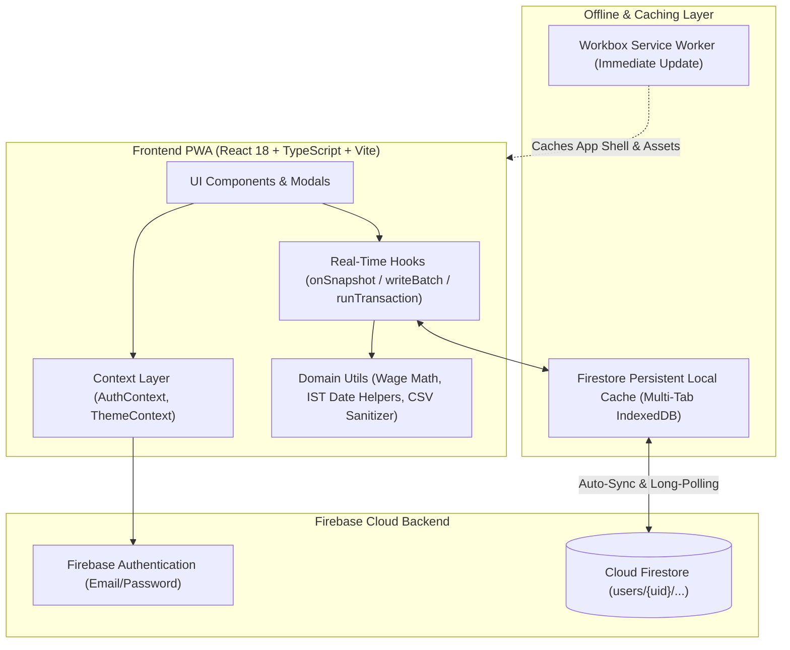
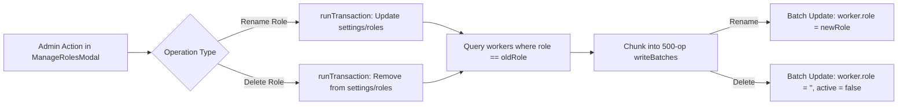
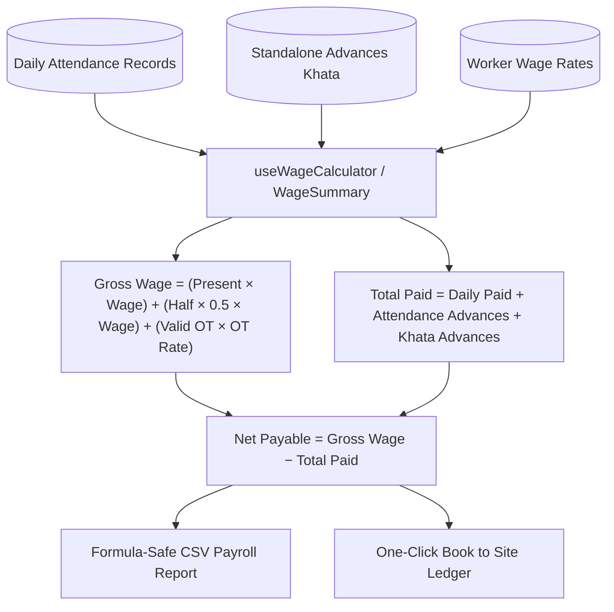
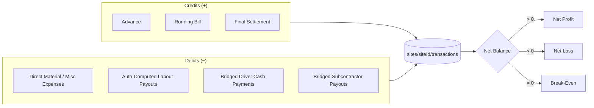
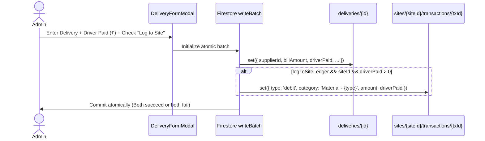
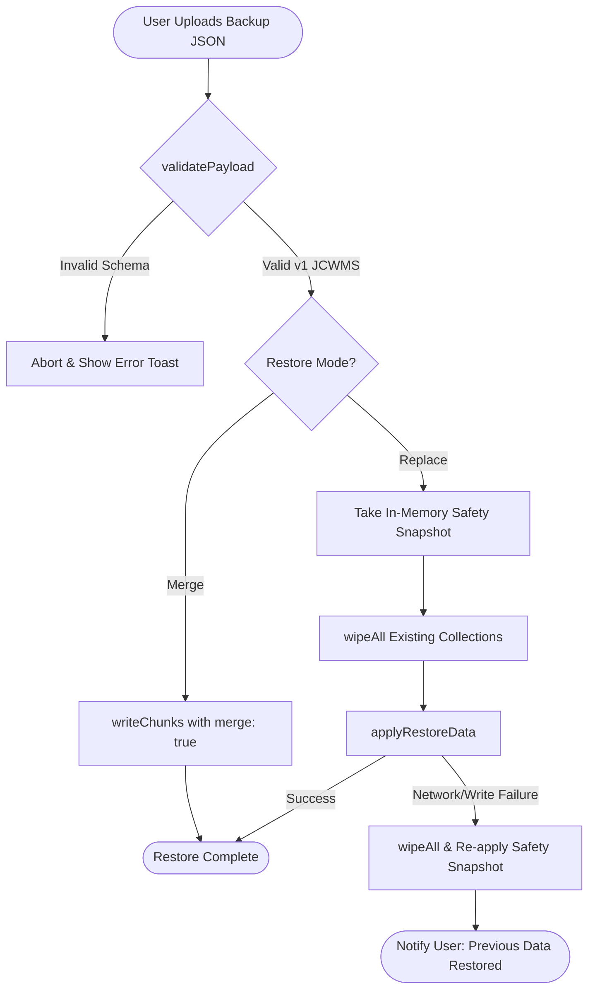
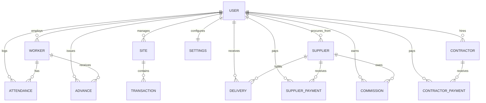

<div align="center">
  
  <h1>Jaiswal Construction Workers Management System (JC-WMS)</h1>
  <p>
    <strong>Offline-First Construction Workforce, Payroll, Site P&amp;L, Material &amp; Subcontractor Management PWA</strong>
  </p>
</div>

---

A comprehensive, offline-first Progressive Web App (PWA) engineered for construction firms, site supervisors, and contractors to manage daily worker attendance, overtime, cash advances (*Khata*), payroll, site-level profit & loss ledgers, material procurement, supplier commissions, and subcontractor payouts.

---

## Table of Contents

- [System Architecture](#system-architecture)
- [Tech Stack](#tech-stack)
- [Core Modules & Workflows](#core-modules--workflows)
  - [1. Workforce & Attendance Management](#1-workforce--attendance-management)
  - [2. Payroll, Advances & Wage Engine](#2-payroll-advances--wage-engine)
  - [3. Multi-Site Financial Ledger](#3-multi-site-financial-ledger)
  - [4. Material Procurement & Supplier Khata](#4-material-procurement--supplier-khata)
  - [5. Subcontractor Directory & Payouts](#5-subcontractor-directory--payouts)
  - [6. System Health, Backup & Disaster Recovery](#6-system-health-backup--disaster-recovery)
- [Firestore Data Model](#firestore-data-model)
- [Financial & Payroll Calculation Rules](#financial--payroll-calculation-rules)
- [Offline Support & PWA Capabilities](#offline-support--pwa-capabilities)
- [Project Structure](#project-structure)
- [Getting Started](#getting-started)
- [Security & Data Integrity](#security--data-integrity)

---

## System Architecture

JC-WMS operates on a **local-first, cloud-synced architecture**. All mutations write directly to Firestore's IndexedDB local cache for zero-latency field usage and synchronize automatically when connectivity is available.



---

## Tech Stack

| Layer | Technology | Purpose |
| :--- | :--- | :--- |
| **Frontend Framework** | React 18 + TypeScript + Vite | Component-driven UI with strict type safety and fast HMR builds. |
| **Styling & UI** | Tailwind CSS + Lucide Icons | Responsive mobile-first design with automatic/manual Dark Mode (FOUC-free). |
| **Backend & Database** | Firebase Auth & Cloud Firestore | Real-time `onSnapshot` subscriptions, atomic `writeBatch` & `runTransaction` writes. |
| **Offline Persistence** | Firestore `persistentLocalCache` + Workbox | Multi-tab IndexedDB caching and immediate service worker registration for zero-connectivity field work. |
| **Localization & Exports** | `Intl.NumberFormat ('en-IN')` + Custom CSV/JSON | Indian Rupee (`₹`) formatting, local timezone (`YYYY-MM-DD`) date handling, and formula-injection-safe CSV exports. |

---

## Core Modules & Workflows

### 1. Workforce & Attendance Management
* **Worker Directory (`WorkerManagement`):** Manage worker profiles including name, phone number, trade/role, daily base wage, and overtime hourly rate. Supports **soft-deletion** (`active: false`) to preserve historical attendance and payroll integrity, alongside reactivation and permanent deletion.
* **Dynamic Role Management (`ManageRolesModal` & `useRoleCascade`):** Add, rename, or delete worker roles (e.g., *Mason, Helper, Carpenter, Electrician, Plumber, Painter, Welder*). Renaming or deleting a role atomically cascades updates across all assigned worker records using chunked Firestore batches (`500` ops/batch).
* **Daily Attendance Matrix (`AttendanceMatrix`) & Worker Profile (`WorkerProfile`):** Track daily status (`Present`, `Half Day`, `Absent`, `Holiday`), overtime hours, on-spot daily payouts, attendance-linked advances, and remarks.
* **Live Metrics Ribbon (`MetricsRibbon`):** Real-time daily dashboard displaying Present, Absent, Half-Day counts, total OT hours, daily advance payouts, and estimated daily labor cost.



### 2. Payroll, Advances & Wage Engine
* **Automated Wage Calculator (`WageSummary` & `useWageCalculator`):** Aggregates monthly attendance per worker to compute gross wages, standalone *Khata* advances, attendance-linked advances, daily payouts, and net payable balances.
* **Advance Ledger (`useAdvances` & `useWorkerAdvances`):** Record standalone cash advances outside of daily attendance, viewable per worker or per month, and exportable to CSV.



### 3. Multi-Site Financial Ledger
* **Multi-Site Management (`SiteSelector`):** Create, edit, switch between, and delete construction sites with client details, phone numbers, start dates, and status (`Active` / `Completed`). Deleting a site cascades deletion across its entire transaction subcollection in `450`-doc batches.
* **Site P&L Ledger (`SiteLedger`):**
  * **Client Receipts (Credits):** Track *Advance*, *Running Bill*, and *Final Settlement* inflows.
  * **Site Expenses (Debits):** Categorize outflows (*Cement, Steel, Sand/Aggregate, Bricks, Transport, Machinery, Food/Misc*) across *Cash, UPI, Bank Transfer,* and *Cheque*.
  * **One-Click Labour Payout Booking:** Automatically computes global workforce wages for a chosen date range and books them directly as a `Labour / Worker Wages` debit entry in the active site's ledger.
  * **Real-Time Profitability:** Displays Total Revenue, Labour Expenses, Material/Other Expenses, Combined Expenses, and Net Profit/Loss/Break-Even status.



### 4. Material Procurement & Supplier Khata
* **Supplier Directory (`MaterialLedger` -> `Suppliers`):** Maintain a directory of material vendors tagged with customizable material types (*Brick, Sand, Aggregate, Cement, Steel, Stone, Other*), GSTIN, contact details, and live billed/due balances.
* **Material Deliveries (`Deliveries`):** Log truckloads, quantities (`cft, pieces, tons, bags, kg, nos`), unit rates, bill amounts, challan numbers, and cash paid to drivers. Includes an atomic **Site Ledger Bridge** that optionally posts driver cash payments straight to the linked site's expense ledger.
* **Commission Tracking (`Commissions`):** Track supplier commissions per material delivery with `Pending`, `Partial`, and `Received` states, incremental receipt logging, and reset capabilities.
* **Supplier Passbook (`Khata`):** Chronological running-balance ledger per supplier combining all delivery bills (`+`) and supplier payments (`−`) to calculate exact Net Due or Advance Paid.



### 5. Subcontractor Directory & Payouts
* **Subcontractor Management (`ContractorPayments`):** Organize specialized trade contractors (*Lohar, Electrician, Plumber, Carpenter, Painter, Mason, Welder, Tiles, Other*) with customizable trade tags.
* **Payment Logging & Site Bridge:** Record payments with work descriptions, payment modes, and reference IDs, with an atomic option to log the payout directly into a linked site's ledger under `Contractor`.
* **Trade & Contractor Analytics:** Aggregated summaries broken down by individual contractor and by trade category.

### 6. System Health, Backup & Disaster Recovery
* **Live Diagnostics (`SystemHealth` & `useSystemHealth`):** Monitors network connectivity, Firebase Auth status, total document counts across all collections, and estimated Firestore storage usage against the 1 GiB free-tier quota (cached for 1 hour in `localStorage`).
* **Full JSON Snapshot & Rollback Restore (`useBackup`):**
  * **Export:** Downloads a complete versioned JSON backup (`JCWMS_Backup_*.json`) of all collections, site subcollections, and user settings.
  * **Merge or Replace Restore:** Supports **Merge** (upserts matching IDs) and **Replace** (wipes existing data first). Replace mode automatically captures an in-memory safety snapshot prior to wiping and rolls back automatically if a network error interrupts the restore.



---

## Firestore Data Model

All user data is strictly isolated under `users/{uid}/`:



```text
users/{uid}/
├── workers/{workerId}               # Worker profiles, wages, active status
├── attendance/{YYYY-MM-DD_workerId} # Daily status, OT hours, daily paid, advances
├── advances/{advanceId}             # Standalone worker advances
├── sites/{siteId}                   # Construction site metadata & status
│   └── transactions/{txId}          # Site-specific credit & debit ledger entries
├── suppliers/{supplierId}           # Material vendors & supplied material tags
├── deliveries/{deliveryId}          # Material deliveries, quantities, driver payouts
├── commissions/{commissionId}       # Supplier commission records & receipt status
├── supplierPayments/{paymentId}     # Payments made toward supplier Khata
├── contractors/{contractorId}       # Subcontractor directory & trade tags
├── contractorPayments/{paymentId}   # Subcontractor payout records
└── settings/
    ├── roles                        # Custom worker roles array
    ├── materialTypes                # Custom material categories array
    └── contractorTrades             # Custom subcontractor trades array
```

---

## Financial & Payroll Calculation Rules

1. **Daily & Aggregate Wages (`src/utils/calculations.ts` & `useWageCalculator.ts`):**
   $$\text{Gross Wage} = (\text{Present Days} \times \text{Daily Wage}) + (\text{Half Days} \times 0.5 \times \text{Daily Wage}) + (\text{Valid OT Hours} \times \text{OT Hourly Rate})$$
   * **Overtime Guardrail:** Overtime pay is calculated on `present`, `half`, and `holiday` statuses, **never** on `absent` days.
   * **Currency Rounding:** All monetary calculations pass through `roundCurrency()` using `Number.EPSILON` precision (`Math.round((num + Number.EPSILON) * 100) / 100`) to prevent floating-point drift.
2. **Net Payable Payroll:**
   $$\text{Net Payable} = \text{Gross Wage} - (\text{Daily Paid} + \text{Khata Advances} + \text{Attendance Advances})$$
3. **Timezone-Safe Dates (`src/utils/date.ts`):**
   * All dates are stored as local `YYYY-MM-DD` strings (`toDateStr()`) rather than `Date.toISOString()` to prevent off-by-one day shifts in timezones east of UTC (such as `IST / UTC+5:30`).

---

## Offline Support & PWA Capabilities

* **Multi-Tab IndexedDB Persistence:** Configured in `src/lib/firebase.ts` using `persistentLocalCache({ tabManager: persistentMultipleTabManager() })` alongside `experimentalAutoDetectLongPolling: true` for reliability on flaky mobile networks or restrictive proxies.
* **Immediate Service Worker Updates:** `registerSW({ immediate: true })` ensures field supervisors running the installed PWA receive updates without manual cache clearing.
* **Network & Install UI:** `NetworkStatus` provides real-time online/offline status pills and sync toast notifications, while `InstallPwaButton` intercepts `beforeinstallprompt` for one-tap home-screen installation.

---

## Project Structure

```text
public/
└── logo.png                      # Application & PWA brand logo
src/
├── components/
│   ├── AttendanceMatrix.tsx      # Daily attendance grid & quick entry
│   ├── AuthScreen.tsx            # Admin email/password login
│   ├── ConfirmDialog.tsx         # Accessible modal with focus trap & Esc handling
│   ├── ContractorPayments.tsx    # Subcontractors, payouts & trade summaries
│   ├── CustomSelect.tsx          # Accessible portal-based combobox/dropdown
│   ├── ErrorBoundary.tsx         # Global React render error catcher
│   ├── InstallPwaButton.tsx      # PWA install prompt trigger
│   ├── ManageRolesModal.tsx      # CRUD modal for worker roles
│   ├── MaterialLedger.tsx        # Suppliers, Deliveries, Commissions & Khata
│   ├── MetricsRibbon.tsx         # Daily workforce & cost KPI cards
│   ├── NetworkStatus.tsx         # Online/Offline indicator & sync banners
│   ├── SiteLedger.tsx            # Site P&L, client receipts, expenses & labour booking
│   ├── SiteSelector.tsx          # Site switcher & site creation/editing modal
│   ├── SystemHealth.tsx          # Storage quota, doc counts, backup & restore UI
│   ├── WageSummary.tsx           # Monthly payroll calculation & CSV export
│   ├── WorkerManagement.tsx      # Worker directory & onboarding
│   └── WorkerProfile.tsx         # Individual worker monthly calendar & history
├── context/
│   ├── AuthContext.tsx           # Firebase Auth state & friendly error mapping
│   └── ThemeContext.tsx          # Light/Dark/System theme state (prevents FOUC)
├── hooks/                        # Real-time Firestore subscriptions & atomic mutations
├── lib/
│   └── firebase.ts               # Firebase initialization, persistence & emulator setup
├── utils/
│   ├── calculations.ts           # Currency rounding & wage math
│   ├── csv.ts                    # Formula-injection-safe CSV & JSON downloads
│   └── date.ts                   # Local YYYY-MM-DD helpers & INR currency formatter
├── App.tsx                       # Main application shell & navigation
└── main.tsx                      # Entry point & PWA service worker registration
```

---

## Getting Started

### Prerequisites
* Node.js (v18+ recommended)
* A Firebase project with **Authentication** (Email/Password enabled) and **Cloud Firestore** enabled.

### Environment Variables
Create a `.env` file in the root directory with your Firebase configuration:

```env
VITE_FIREBASE_API_KEY=your_api_key
VITE_FIREBASE_AUTH_DOMAIN=your_project.firebaseapp.com
VITE_FIREBASE_PROJECT_ID=your_project_id
VITE_FIREBASE_STORAGE_BUCKET=your_project.appspot.com
VITE_FIREBASE_MESSAGING_SENDER_ID=your_sender_id
VITE_FIREBASE_APP_ID=your_app_id

# Optional: Local Firebase Emulator Suite
VITE_USE_EMULATOR=false
VITE_EMULATOR_HOST=localhost
```

### Installation & Running
```bash
# Install dependencies
npm install

# Start local development server
npm run dev

# Build production bundle
npm run build
```

---

## Security & Data Integrity

* **CSV Formula Injection Protection (`src/utils/csv.ts`):** All exported CSV cells starting with `=`, `+`, `-`, `@`, `\t`, or `\r` are automatically prefixed with a single quote (`'`) to prevent spreadsheet formula execution, while preserving legitimate negative numbers (e.g., `-500`).
* **Atomic Cross-Collection Writes:** Operations that span multiple collections—such as logging a material delivery or contractor payment and simultaneously posting it to a Site Ledger—execute inside a single `writeBatch` so partial writes never occur.
* **Concurrency Protection:** Role updates, trade/material list additions, and commission receipts utilize `runTransaction` to prevent race conditions across concurrent sessions.
